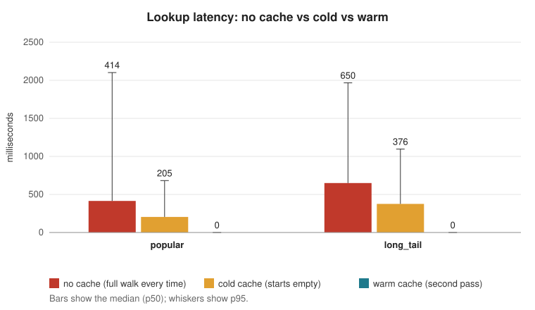
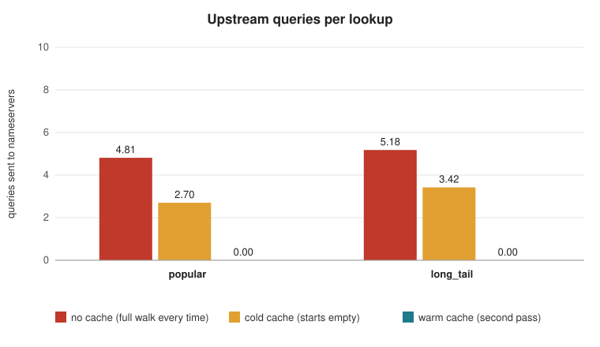

# Iterative DNS Resolver with Caching

CS-30003 · Coding Assignment 1 · Project P2 (Path A)

A DNS resolver and caching DNS server written from scratch in C++17, at the socket
level, with no DNS libraries. Instead of forwarding questions to a resolver like
8.8.8.8, it walks the DNS hierarchy itself, **root → TLD → authoritative**, then
caches what it learns so repeated lookups are answered locally.

📄 **[Project report](docs/REPORT.md)** · 🎤 **[Viva prep and demo script](docs/VIVA.md)**

## Team

| Member | Owns | Folder |
|---|---|---|
| Ojaswit Singh (24052398) | Iterative resolution engine, DNS server mode | `src/resolver/`, `src/server/` |
| Riya Koshyari (2405015) | Wire-format codec (RFC 1035 encode/decode, name compression) | `src/dns/` |
| Bhardwaaj Singh (24159004) | Caching layer (TTL expiry, negative caching per RFC 2308) | `src/cache/` |
| Kavish Tewari (24155704) | Transport (UDP retry/timeout, TCP fallback on TC) | `src/net/` |

## What works

| Proposal deliverable | Status |
|---|---|
| RFC 1035 wire-format encoder/decoder, including compression pointers | ✅ |
| Full iterative resolution: root hints → TLD → authoritative, no forwarding | ✅ |
| A, AAAA, NS, CNAME, MX, TXT, SOA, with glue records and CNAME chains | ✅ |
| UDP with retry, timeout and server selection; TCP fallback when TC is set | ✅ |
| Caching server mode: TTL expiry, negative caching (RFC 2308), loop/depth protection | ✅ |
| Validation: point the OS resolver at our server and browse through it | ✅ `nslookup` verified; see [Browse through it](#browse-the-web-through-it) |
| Experiment: cold vs. warm cache | ✅ see [Experiment](#experiment-the-claim) |

## How it works

```
 client (nslookup / OS / browser)
          │  UDP query
          ▼
 ┌──────────────────┐     ┌────────────────────┐
 │  server          │────▶│  resolver          │──── cache hit? ──▶ answer at once
 │  src/server      │     │  src/resolver      │
 └──────────────────┘     └─────────┬──────────┘
                                    │ cache miss: walk the hierarchy
            ┌───────────────────────┼─────────────────────────┐
            ▼                       ▼                         ▼
     root server  ──referral──▶  .com server  ──referral──▶  example.com's server ──▶ answer
     "ask .com"                  "ask ns.cloudflare.com"     "104.20.23.154"

 codec  (src/dns)   turns messages into bytes and back
 transport (src/net) sends the bytes over UDP, and again over TCP if the reply was truncated
 cache  (src/cache)  remembers answers, delegations and "does not exist" results until their TTL runs out
```

A real cold lookup, printed by `resolve`:

```
$ resolve www.example.com A
;; run 1: NOERROR, 3 upstream queries, 211 ms
;;   ask 192.203.230.10 [.] for www.example.com A
;;     -> referral to com (13 nameservers)
;;     glue: 13 address(es)
;;   ask 192.5.6.30 [com] for www.example.com A
;;     -> referral to example.com (2 nameservers)
;;     glue: 6 address(es)
;;   ask 108.162.192.162 [example.com] for www.example.com A
;;     -> answer: 2 record(s)
www.example.com 300 IN A 104.20.23.154
www.example.com 300 IN A 172.66.147.243
```

What the resolver handles on each reply:

| Reply contains | What the resolver does |
|---|---|
| The requested records | Returns them and caches them |
| A CNAME | Follows the alias, from the cache or from the root (up to 8 hops) |
| NS records (a referral) | Uses the glue addresses to ask the next zone's servers. Without glue, it resolves the nameserver's own name first |
| NXDOMAIN, or an empty answer with an SOA | Returns "does not exist" / "no records of this type" and caches it negatively |
| A timeout, a malformed packet, SERVFAIL/REFUSED | Tries the next server |
| A lame reply: not authoritative, no answer, and a referral back to the same zone | Tries the next server (found live: `dns2.openbsd.org` does this) |
| A truncated reply (TC set) | Asks the same server again over TCP |

Safety limits: at most 60 upstream queries per lookup, 8 CNAME hops, and 4 levels of
nested nameserver lookups. Records from a server about zones outside its authority
are ignored, which stops a server from planting answers for someone else's domain.

## Repository layout

```
src/dns/        message types, codec (+ codec_test)
src/net/        sockets, UDP/TCP transport (+ transport_test)
src/cache/      TTL and negative cache (+ cache_test)
src/resolver/   iterative engine, root hints, `resolve` CLI (+ resolver_test)
src/server/     caching DNS server, `serve` CLI (+ server_test)
src/common/     tiny test helpers
tools/          dns_query (one raw query), experiment (benchmark harness)
experiment/     lookup lists, plot script, results
docs/           project report, viva prep
```

## Build

Requirements: a C++17 compiler, CMake 3.16+ and Ninja (or make).

```bash
cmake -S . -B build -G Ninja
cmake --build build
ctest --test-dir build --output-on-failure
```

Builds on Windows (MinGW-w64) and Linux/macOS; socket differences are handled in
`src/net/socket_compat.h`. All five test suites run offline, using fake nameservers.

## Run it

### Resolve one name

```bash
./build/src/resolver/resolve www.github.com A             # prints every step of the walk
./build/src/resolver/resolve www.github.com A --repeat 2  # second run comes from the cache
./build/src/resolver/resolve gmail.com MX --quiet
```

Options: `[type]` (A, AAAA, NS, CNAME, MX, TXT, SOA, or TYPEnn), `--repeat N`,
`--quiet`, `--no-cache`.

### Run the DNS server

```bash
./build/src/server/serve              # listens on 127.0.0.1:53
./build/src/server/serve --trace      # also prints each resolver step
```

Then, from another terminal:

```bash
nslookup www.github.com. 127.0.0.1
```

Every query is logged:

```
127.0.0.1:57816  www.github.com A -> NOERROR, 2 answer(s), 3 upstream, 264 ms
127.0.0.1:57823  www.github.com A -> NOERROR, 2 answer(s), 0 upstream, 0 ms
```

Notes:
- On Windows, port 53 needs no admin rights. Windows `nslookup` ignores `-port`, so
  run the server on 53 when testing with it.
- End names with a dot (`www.github.com.`). Otherwise `nslookup` may first add your
  network's DNS search suffix and ask for something like `www.github.com.domain.name`.
- On Linux, port 53 needs root, and `systemd-resolved` may already be using
  127.0.0.53. Use `sudo ./build/src/server/serve`, or `--port 5300` with
  `dig @127.0.0.1 -p 5300 www.github.com`.

### Browse the web through it

1. Start the server: `./build/src/server/serve`
2. Windows: **Settings → Network & internet → (Wi-Fi or Ethernet) → Hardware
   properties → DNS server assignment → Edit → Manual**. Turn on IPv4, set
   *Preferred DNS* to `127.0.0.1`, and leave IPv6 DNS off, because the server only
   listens on IPv4.
3. In the browser, turn off **Settings → Privacy → Use secure DNS**. Otherwise
   the browser sends DNS over HTTPS and never asks the OS.
4. Run `ipconfig /flushdns`, then open some sites. Each lookup appears in the
   server's log.
5. When you're done, set DNS back to **Automatic**.

## Experiment: the claim

> A warm-cache iterative resolver answers repeated queries with materially lower
> latency and far fewer upstream queries than a cold resolver performing a full
> root → TLD → authoritative walk every time, without sacrificing correctness.

**Method.** `tools/experiment` replays a fixed list of names in three modes, three trials each:

| Mode | Meaning |
|---|---|
| `no-cache` | Every lookup walks from the root, the same walk `dig +trace` does (the baseline) |
| `cold` | One cache that starts empty; later names reuse delegations learned from earlier ones (e.g. `.com`) |
| `warm` | The same cache, replaying the same list a second time |

- **Variables:** cache state and query mix. The mixes are `popular` (30 big sites,
  [traces/popular.txt](experiment/traces/popular.txt)) and `long_tail` (30 smaller sites
  across many TLDs, plus two names that don't exist,
  [traces/long_tail.txt](experiment/traces/long_tail.txt)).
- **Controls:** the same lists, the same root hints, and the same timeout and retry
  settings in every run.
- **Metrics:** p50/p95 latency, upstream queries per lookup, cache hit ratio (lookups
  answered with 0 upstream queries).
- **Correctness:** three checks.
  - **Warm = cold:** warm answers must equal the cold answers exactly.
  - **Same outcome as 1.1.1.1:** every lookup is also sent to Cloudflare's public
    resolver, and both must agree on "found" vs "does not exist".
  - **Shares an address with 1.1.1.1:** for names both resolved, at least one
    returned record must be the same. Exact equality would be unfair, because CDNs
    give different resolvers different addresses on purpose.

Reproduce:

```bash
./build/tools/experiment experiment/traces/popular.txt   --mix popular   --trials 3 --out experiment/results/popular.csv
./build/tools/experiment experiment/traces/long_tail.txt --mix long_tail --trials 3 --out experiment/results/long_tail.csv
python experiment/plot.py experiment/results/popular.csv experiment/results/long_tail.csv -o experiment/results
```

### Results

270 lookups per mix (30 names × 3 modes × 3 trials), run from one machine in India
on 2026-10-27. Raw data: [popular.csv](experiment/results/popular.csv),
[long_tail.csv](experiment/results/long_tail.csv). Table: [summary.md](experiment/results/summary.md).

| Mix | Mode | p50 latency | p95 latency | Upstream queries / lookup | Cache hit ratio | Same outcome as 1.1.1.1 | Shares an address with 1.1.1.1 | Warm = cold |
|---|---|---:|---:|---:|---:|---:|---:|---:|
| popular | no-cache | 414 ms | 2102 ms | 4.81 | 0% | 100% | 80% | - |
| popular | cold | 205 ms | 682 ms | 2.70 | 0% | 100% | 81% | - |
| popular | **warm** | **0 ms** | **0 ms** | **0.00** | **100%** | 100% | 81% | **100%** |
| long_tail | no-cache | 650 ms | 1967 ms | 5.18 | 0% | 100% | 100% | - |
| long_tail | cold | 376 ms | 1096 ms | 3.42 | 0% | 100% | 100% | - |
| long_tail | **warm** | **0 ms** | **0 ms** | **0.00** | **100%** | 100% | 100% | **100%** |





### What it shows

- **The claim holds.** With a warm cache, every repeated lookup was answered locally:
  0 upstream queries and well under a millisecond, against a median of 414–650 ms
  and about 5 queries for a full walk from the root.
- **Even a cold cache helps a lot.** Within a single pass, later names reuse the
  `.com`/`.org` delegations learned by earlier ones. That alone cuts queries per lookup
  by about 35–45% and median latency by about 42–51%. Most of the saving comes from
  not asking the root and TLD servers again, which is why the resolver also caches
  NS and glue records, not just final answers.
- **Long-tail names cost more cold.** They are spread over more TLDs (`.ac.in`,
  `.co.uk`, `.de`, `.jp`, ...), so there are fewer shared delegations to reuse:
  3.42 vs 2.70 queries per cold lookup. Warm, both mixes are the same.
- **Correctness is not sacrificed.** Warm answers equal cold answers in 100% of
  lookups, and the outcome ("found" vs "does not exist") matches 1.1.1.1 for all 540
  lookups. The 19–20% of popular lookups with no address in common are Google,
  YouTube, WhatsApp, Microsoft and X. These sites answer each resolver with servers
  near it, so 1.1.1.1's addresses differ from ours on purpose.
- **p95 latency** for cold walks is dominated by slow or unreachable nameservers, where
  the resolver waits for a timeout before trying the next one.

### Things the experiment uncovered

- **A lame nameserver.** `dns2.openbsd.org` answers questions about `openbsd.org`
  without authority, referring back to the same zone. The first version of the
  resolver gave up (SERVFAIL) whenever it happened to pick that server. It now skips
  such servers, and `resolver_test` covers the case.
- **"Compact denial of existence".** For a name that doesn't exist, Cloudflare's
  authoritative servers tell our resolver NXDOMAIN, but tell DNSSEC-validating resolvers
  (1.1.1.1, 8.8.8.8, 9.9.9.9) NOERROR with no records. Both mean "nothing here", so the
  comparison treats them as the same outcome.
- **Truncated root replies.** Without EDNS, root referrals don't fit in 512 bytes.
  Before TCP fallback the resolver saw 6–7 `.com` server addresses; with it, all 13.

### Comparing with `dig +trace`

The `no-cache` mode makes the same walk as `dig +trace`. On Linux or macOS you can
check a single name by hand:

```bash
dig +trace www.github.com
./build/src/resolver/resolve www.github.com A --no-cache
```

Both walk the same three steps: root → `com` → `github.com`. (`dig +trace` also
asks for the root server list first, so it sends one extra query.)

## Known limitations

- Nameservers are contacted over IPv4 only. AAAA records can still be looked up.
- No DNSSEC validation.
- The server answers over UDP only. A client that gets a truncated reply and retries
  over TCP gets no answer (rare for normal websites).
- The cache is in memory only and starts empty each time the server starts.
- A warm NXDOMAIN or NODATA answer comes back without its SOA record, because the
  cache stores only the outcome and its expiry.
